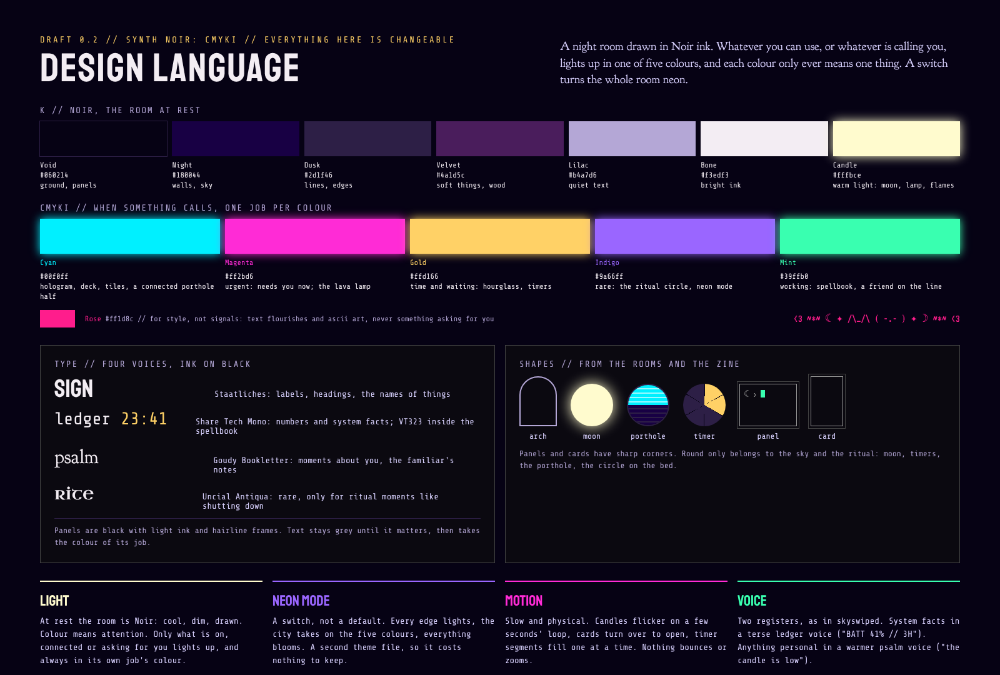

# Design language: Synth Noir CMYKI (draft 0.2)

Chosen by Zoë on 20 October 2026. Everything here is changeable. In Step 3 these values move
into the theme file, so this page is the list the theme file will be built from.

## The idea in one breath

A night room drawn in Noir ink. Whatever you can use, or whatever is calling you, lights up in
one of five colours, and each colour only ever means one thing. A switch turns the whole room
neon.

There are three states:

| State | What it looks like | What is in it |
| --- | --- | --- |
| At rest | Noir: cool, dim, drawn | shelves, walls, bed, altar, books, plants: anything fixed or asleep until called |
| Called | CMYKI colour, one job per colour | moon clock, porthole, hologram, spellbook, circle, lamp, lava lamp, lit candles, the familiar's notes |
| Neon mode | every edge lit, the city coloured, everything glows | the whole room; a switch, not the default |

## Palette

### K: Noir, the room at rest

| Name | Hex | Used for |
| --- | --- | --- |
| Void | `#060214` | the ground, panel backgrounds, deepest shadow |
| Night | `#180044` | walls, sky |
| Dusk | `#2d1f46` | lines, edges |
| Velvet | `#4a1d5c` | soft things, wood |
| Lilac | `#b4a7d6` | quiet text |
| Bone | `#f3edf3` | the brightest ink |
| Candle | `#fffbce` | warm light: the moon, the lamp, candle flames |

Plants are a dark, quiet, under-saturated green, not a bright one.

### CMYKI: when something calls

| Name | Hex | Its one job |
| --- | --- | --- |
| Cyan | `#00f0ff` | the hologram, the tarot deck, window tiles, and a connected half of the porthole |
| Magenta | `#ff2bd6` | urgent: something needs you now. Also the lava lamp |
| Gold | `#ffd166` | time and waiting: the hourglass, timers |
| Indigo | `#9a66ff` | rare: the ritual circle and neon mode |
| Mint | `#39ffb0` | working: the spellbook, a friend on the line |

### Plus Rose, for style

| Name | Hex | Used for |
| --- | --- | --- |
| Rose | `#ff1d8c` | text flourishes and ascii art only. Never a signal, never something asking for you |

## Type: four voices

| Voice | Font | Used for |
| --- | --- | --- |
| sign | Staatliches | labels, headings, the names of things |
| ledger | Share Tech Mono (VT323 inside the spellbook) | numbers and system facts |
| psalm | Goudy Bookletter 1911 | moments about you, the familiar's notes |
| rite | Uncial Antiqua | rare: ritual moments like shutting down |

Text and panels are ink on black: black panels, light ink, thin hairline frames. Text stays grey
until it matters, then it takes the colour of its job (the prompt, the cursor, an unread note).

## Shapes

Panels and cards have sharp corners. Round shapes belong only to the sky and the ritual: the moon,
timers, the porthole and the circle on the bed. Gothic arches come from the altar and the ledge.

The porthole is wi-fi above and bluetooth below. A connected half fills with glowing cyan in soft
level bands; an idle half stays Noir.

## Rules

- **Light.** At rest the room is Noir. Colour means attention: only what is on, connected or
  asking for you lights up, and always in its own job's colour.
- **Neon mode.** A switch, not a default. Every edge lights up, the city takes on the five colours,
  and everything glows. It is a second theme file, so it costs nothing to keep.
- **Motion.** Slow and physical. Candles flicker on a loop of a few seconds, cards turn over to
  open, timer segments fill one at a time. Nothing bounces or zooms.
- **Voice.** Two registers, as in skyswiped. System facts in a short ledger voice
  ("BATT 41% // 3H"). Anything personal in a warmer psalm voice ("the candle is low").

## Pictures

| File | What it shows |
| --- | --- |
| `synth-noir-cmyki.png` | the look board: the room, the colour jobs, the text panels and neon mode |
| `room-synth-noir.png` | the room at rest with things called, in Synth Noir CMYKI |
| `room-neon-mode.png` | the same room with neon mode switched on |
| `design-language.png` | this page as a board |
